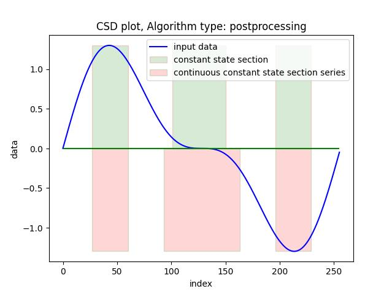

# This is the web client description for the Constant State Detection in Timeseries algorithm webservice.
## You can take a look at the [perprint with the introduction to the algorithm here.](https://figshare.com/articles/preprint/The_effective_algorithm_for_constant_state_detection_in_time_series_V_2_3_/28375532)

## Requires Python 3.10+
## Installation:

Recommended:
### 1. Create a virtual environment. 
<p>
For Linux: execute the console command
</p>
<p>
<b>python3 -m venv your_path_to_new_virtual_environment</b>
</p>
<p>
for other operating system there could be different command(s)
</p>

### 2. Activate it.  
<p>
For Linux: execute the console command
</p>
<p>
<b>source your_path_to_new_virtual_environment/bin/activate</b>
</p>
<p>
for other operating system there could be different command(s)
</p>

### 3. Install the package.
<p>
execute the console command
</p>
<p>
<b>pip install csd-algo
</p>


### Quick check if it is working
<p>
now execute the console command
</p>
<p>
<b>python -m csd_algo.usage_example</b>
</p>
<p>
If all have been done correctly, you should see the console output and a couple of plots like this:

</p>

### Now create the <span style="color: blue;">github_example.py</span> file  and paste the following code into it:

```python

import requests
import matplotlib.pyplot as plt
from csd_algo.client_axiliary import report_results, __version__
from csd_algo.models import (MAX_CSD_POINTS_FREE, CSD_Data,  
                    to_jsonable_dict)
from csd_algo.generate_timeseries_numpy import generate_timseries

plt.close('all')
 
url_csd_algo = 'https://dazzling-faithful-banteng.anvil.app/constant-state-detection'

ts: list[float] = generate_timseries(
    0.5, 
    MAX_CSD_POINTS_FREE,
    ).tolist()

# process the timeseries with the default settings:
    
csd_data = CSD_Data(csd_algo_input=ts, 
                    csd_algo_min_window_width=16, 
                    csd_algo_max_window_height=0.08)

# send the data to the server and receive the reply
response = requests.post(url_csd_algo, 
                         json=to_jsonable_dict(csd_data))

# validate received data
out_data = CSD_Data.model_validate(response.json())

# print and plot the processing results
report_results(out_data, 
               f'CSD plot, Algorithm type: postprocessing')

print(f'Client version is {__version__}')

```

<h3>
Save the file and execute the console command
</h3>
<p>
<b>python github_example.py</b>
</p>
<p> 
Now you should see some console output and just one plot like 
the picture above.
</p>
<p>
After completing and verifying these steps, you can adjust the input data and algorithm parameters to 
<b>test the algorithm implementation</b> 
according to your requirements.
</p>
<h3> 
It might be helpful to take a look at the code for the class used as the webservice input data:
</h3>

```python

class CSD_Data(BaseModel):
    """
    class to hold the Constant State Detection algorithm data
    #
    values:
    # 
    csd_algo_input: 
        [in] input timeseries 
    # csd_algo_min_window_width: 
        [in] minimal window width
    # csd_algo_max_window_length: 
        [in] maximal window height
    # Algo_Type: 
        [in] AlgorithmType value
    # Window_Height_Type: 
        [in] WindowHeightType value
    # start: 
        [out] list of start constant section series indexes inclusive
    # finish: 
        [out] list of finish constant section series indexes inclusive
    # start_section_series: 
        [out] list of start continuous constant 
        state section indexes inclusive
    # finish_section_series: 
        [out] list of finish continuous constant 
        state section indexes inclusive
    # api_key: 
        [in] reserved for future use
    # csd_algo_info: 
        [out] list of infromation strings
    # csd_algo_warnings: 
        [out] list of warning strings
    # csd_algo_errors: 
        [out] list of error strings
    # 
    see also: 
    https://figshare.com/articles/preprint/The_effective_algorithm_for_constant_state_detection_in_time_series_V_2_3_/28375532?file=56562641

    """

    csd_algo_input: list[float]
    csd_algo_min_window_width: int
    csd_algo_max_window_height: float
    Algo_Type: AlgorithmType = AlgorithmType.POSTPROCESSING_V1
    Window_Height_Type: WindowHeightType = WindowHeightType.Relative
    start: list[int] = []
    finish: list[int] = []
    start_section_series: list[int] = []
    finish_section_series: list[int] = []
    api_key: str = ''
    csd_algo_info: list[str] = []
    csd_algo_warnings: list[str] = []
    csd_algo_errors: list[str] = []
	
```

### The main parameters here are:
- csd_algo_input: list[float] - this is the timeseries input data for the algorithm
- csd_algo_min_window_width: int - this is the minimal window width input for the algorithm
- csd_algo_max_window_height: float - this is the maximal window height input for the algorithm

<h3> 
It is better to leave the parameters Algo_Type and Window_Height_Type values to have their default 
values for the beginning. Algo_Type.POSTPROCESSING_V1 
value means advanced algorithm 
which chooses the 'best' constant state section
with the minimal height from sections that 
have the maximal length from one continuous constant 
state section series.
</h3>
	


<h3> 
It might also be helpful to take a look at the code to create the numpy array used for testing:
</h3>

```python

def generate_timseries(b: float, points_cnt: int=256, 
                       periods: int=1, 
                       phi: float = 0) -> np.array:
        """
        function to generate the test timeseries for the 
        constant state detection algorithm demo. returns the 
        float numpy array with the sin(x) + b * sin(2 * x + phi)
        sum of the first and the second harmonic inside.

        input parameters:
        * b - float, the value of the second harmonic
        * points_cnt - int, the count of the points in the output array
        * periods - int, the period count of the first harmonic
        * phi - float, the phase of the second harmonic in the radians, multiplied by the PI value
        """

        points = int(periods * points_cnt)
        phase = phi * np.pi
        x = np.arange(points)
        y = np.sin(2.0 * np.pi * periods * x / points)
        sin2 = b * np.sin(4.0 * np.pi * periods * x / points + phase)
        y += sin2
        return y
    
```
<h3> Using these definitions, one can easily test the algorithm with 
one's own input data; for example load them from a file, just don't forget about the MAX_CSD_POINTS_FREE input point count restriction.
</h3>

<h1>
	Important note: Unfortunately, I can't guarantee at the moment that the webservice will work with the good uptime 
	and response time, as this is just a free test version of the webservice. 
	There might be times when the webservice will be inaccessible for hours, maybe even for days. 
</h1>
